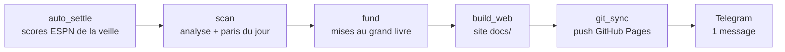

# Architecture du Bot

Retour : [[00 - Dashboard]] · Règles : [[Stratégie Analyste Contextuel]] · Quota : [[Gestion du Quota API]]

## Pipeline quotidien (11 h 30, `bot.py daily`)



## Flux d'un scan

```mermaid
flowchart LR
    A[/sports<br>gratuit/] --> B[Compétitions couvertes ESPN<br>+ rotation pondérée]
    B --> C[/events<br>gratuit/]
    C -->|matchs dans 48 h| D[/odds h2h + totals<br>2 crédits en football/]
    D --> E[Dé-vigging Pinnacle<br>+ appariement Betclic]
    E --> S[/Stats ESPN<br>gratuit, cache 24 h/]
    S --> P[Modèle de Poisson<br>BTTS · Over/Under · DC · DNB]
    P --> F[Score d'Opportunité<br>marché · cote · stats]
    F --> G[3 profils<br>SAFE · SWEET SPOT · AUDACIEUX]
    G --> T[Top 5 du scan<br>1 pari par match]
    T --> H[Fiches d'analyse<br>02 - Paris Détectés]
    H -->|nouvelles fiches| I[Récapitulatif Telegram]
```



## Modules (`betclic-bot/src/betclic_bot/`)

| Module | Rôle |
|---|---|
| `rules.py` | Constantes métier (miroir de `CLAUDE.md`) |
| `odds_api.py` | Client The Odds API v4, lecture des en-têtes de quota |
| `quota.py` | Budget mensuel, rotation des sports, état persistant `data/quota_state.json` |
| `sports.py` | Sports éligibles, noms français, poids de priorité |
| `devig.py` | [[Dé-vigging Pinnacle]] (multiplicative, power) |
| `value.py` | [[Expected Value (EV)]], mise selon le profil |
| `detector.py` | Appariement des marchés [[Pinnacle]] ↔ [[Betclic]], issue par issue |
| `stats_client.py` | Stats ESPN : classement, forme, domicile/extérieur, moyennes, blessures NBA ; noms rapprochés, cache 24 h |
| `poisson.py` | [[Modèle de Poisson]] calibré sur Pinnacle (1N2 + totals) |
| `derived.py` | Marchés dérivés : double chance, remboursé si nul, BTTS, Over/Under, buts d'une équipe, handicap ±1.5 |
| `analyzer.py` | [[Score d'Opportunité]], [[Profils de risque]], argumentaire, point de vigilance, Top du scan |
| `obsidian.py` | Création/mise à jour des fiches, hubs, bilan mensuel, `settle` |
| `notifier.py` | Message Telegram quotidien unique |
| `ledger.py` | Grand livre `data/ledger.json` : opérations, soldes, ROI, yield, drawdown |
| `fund.py` | Paris du jour : 2 à 4 simples + Combiné du jour, mises proportionnelles, plafond 35 % |
| `combo.py` | Combiné du jour (2 – 3 sélections, cote 1.70 – 2.40) |
| `auto_settle.py` | Règlement automatique sur les scores finaux ESPN |
| `build_web.py` | Site public `docs/` (GitHub Pages) |
| `git_sync.py` | Commit + push quotidien, avec garde-fous anti-secrets |
| `scanner.py` | Orchestration d'un run |

## Cycle de vie d'une fiche

1. **Sélection** (Top du scan) → fiche créée avec `statut: EN_ATTENTE` (modèle : [[Modèle - Fiche Pari]]).
2. **Scans suivants** → seules `cote_betclic_actuelle`, `ev_actuel_percent`, `derniere_maj` et l'historique bougent.
3. **Après le match** → vous passez `statut` à `GAGNE` / `PERDU` / `REMBOURSE` / `NON_JOUE`.
4. **`bot.py settle`** → `profit` calculé, [[Bankroll]] mise à jour automatiquement.

## Vue graphique

Chaque fiche pointe vers `[[Sport]]`, `[[Ligue]]`, [[Stratégie Analyste Contextuel]], [[Profils de risque]] et [[Score d'Opportunité]].
Les hubs sont créés automatiquement dans `04 - Sports & Ligues/`, et chaque ligue pointe vers son sport.

## Installation

```bash
cd betclic-bot
python3 -m venv .venv
.venv/bin/pip install -r requirements.txt
cp .env.example .env   # puis renseigner ODDS_API_KEY, TELEGRAM_BOT_TOKEN, TELEGRAM_CHAT_ID
.venv/bin/python bot.py test-telegram
.venv/bin/python bot.py scan --dry-run --max-sports 1
.venv/bin/python -m pytest
```
